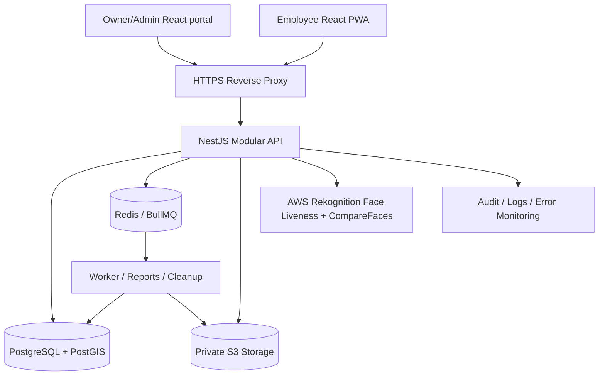
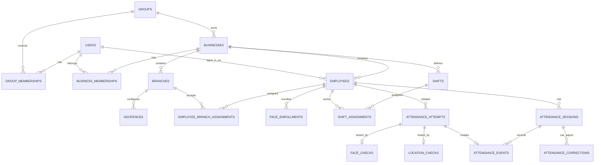

# Multi-Business Selfie & GPS Attendance Platform

**Version:** 1.0 — Architecture baseline (21 October 2026)

> **Product clarification, 21 October 2026:** See [the current product and hosting plan](docs/product-plan.md) for the selected Cloudflare frontend, Render backend, existing Neon database, requested Google Sheets reporting and confirmed automatic face comparison. Private R2 storage is proposed; the face/liveness provider and budget remain undecided. That plan supersedes the hosting recommendations below. The AWS-specific flow below remains a reference option, not a selected deployment. Required verification safeguards remain in force while the provider is evaluated.

## 1. Selected product configuration

- Single owning group with multiple independently managed businesses.
- Employee activation: admin issues single-use, expiring activation code; employee creates secure PIN; subsequent logins use business code, employee ID and PIN.
- Required liveness and 1:1 facial comparison at both check-in and check-out. Failed/unsupported checks enter a supervised exception workflow; they never auto-mark attendance.
- Onsite-only: check-in and check-out against assigned branch geofence and current employee assignment.
- Mobile-first employee PWA; responsive web portals for group owner, business admin, branch manager.
- Server is authoritative for time, permissions, verification and attendance state.

## 2. Non-goals for v1

- Public multi-tenant SaaS sign-up, tenant billing, subscriptions.
- Continuous employee GPS tracking, background surveillance, GPS history between punches.
- Automatic payroll disbursement; import/export for payroll is in scope.
- Native Android/iOS apps. The employee experience is browser-based PWA.
- Offline proof of attendance or bypassing mandatory face verification.
- Facial identification/search across all staff (only 1:1 comparison against the enrolled employee).

## 3. Architecture



### Reference stack

- Monorepo: pnpm workspaces (+ Nx if useful).
- Frontend: React, Vite, TypeScript, MUI for admin, responsive design, PWA manifest/service worker.
- Backend: Node.js, NestJS, TypeScript, OpenAPI/Swagger, validation with Zod or class-validator consistently.
- PostgreSQL with PostGIS `geography(Point, 4326)` for per-branch geofences; Prisma for data access with raw SQL migrations for PostGIS and PostgreSQL partial indexes.
- Redis + BullMQ for exports, notifications and retention cleanups; core attendance decisions remain synchronous.
- Private AWS S3 (or a region-compatible private S3 store), object encryption, tightly scoped access.
- AWS Rekognition Face Liveness (`CreateFaceLivenessSession`, React Amplify `FaceLivenessDetector`, `GetFaceLivenessSessionResults`) + `CompareFaces`.
- DigitalOcean API container and managed DB; AWS Rekognition/S3 in Mumbai where configured. Keep biometric artifacts in approved geographic region(s).
- Logging: Sentry, structured API logs, audit events, health probes, alerts.

## 4. Personas and authorization

**GROUP_OWNER:** global group administration; manage businesses, cross-business reports and admin memberships; cannot bypass biometric checks invisibly.

**BUSINESS_ADMIN:** employees, branches, policies, enrollment approvals, attendance corrections and reports within assigned business only.

**BRANCH_MANAGER:** only assigned branches and employees; attendance monitoring and optionally approving local correction requests.

**EMPLOYEE:** own assigned business, personal attendance, request correction, check in/out, manage PIN.

Enforce authorization in service layer and queries. Never accept business_id, employee_id or roles from client as authoritative; derive principal and memberships from server session. Optional PostgreSQL RLS provides a second boundary. Global/group owner role is not a business membership.

## 5. Modules

| Module | Responsibilities | Key tables |
|---|---|---|
| Group/Business | Owner, business creation, settings, timezone | groups, businesses, group_memberships |
| Authorization | Login, sessions, RBAC, activation, PIN reset, brute force defense | users, credentials, activation_tokens, sessions, memberships |
| Branch/Geofence | Branch CRUD, GPS point/radius, site assignment | branches, geofences, employee_branch_assignments |
| Employees | Employee CRUD, status, photo enrollment state | employees, face_enrollments |
| Shifts | Shift templates, effective dated assignments, night shifts | shifts, shift_assignments, calendars |
| Attendance | Challenges, attempts, verified events, open sessions | attendance_attempts, attendance_sessions, attendance_events |
| Face verification | Liveness provider integration, comparison, score outcomes | face_checks, face_enrollments |
| Location verification | Accuracy, freshness, branch distance, anomaly rules | location_checks, geofences |
| Corrections | Exception requests, two-step review for risky changes | attendance_corrections, approvals |
| Dashboard | Present/late/absent computation, live view, branch filtering | read queries/materialized views |
| Reports | Daily/monthly exports, payroll-ready CSV/XLSX | report_jobs |
| Audit/Privacy | Immutable changes, retention, notices, deletion requests | audit_logs, privacy_notices, retention_jobs |
| Notifications | Account activation and attendance exception notices | notification_jobs |

## 6. Logical entity relationships



### Tables with principal columns

- `groups(id, name, created_at)`.
- `businesses(id, group_id FK, code UNIQUE, name, timezone DEFAULT 'Asia/Kolkata', status, created_at)`.
- `users(id, display_name, phone, status, created_at)` — one login principal; owners/admins/employees can share accounts with different memberships.
- `group_memberships(id, group_id, user_id, role)` — `GROUP_OWNER`.
- `business_memberships(id, business_id, user_id, role, scope_json)` — admin and manager scope; no trust of client claims.
- `employees(id, business_id, user_id NULL FK, employee_code, full_name, phone, status, joined_on, created_at)`; UNIQUE `(business_id, employee_code)`.
- `credentials(user_id, pin_hash, changed_at, failed_attempts, locked_until)`; use Argon2id with server-side throttling; never store plaintext PIN or activation codes.
- `activation_tokens(id, business_id, employee_id, token_hash, expires_at, consumed_at, issued_by)`; one use, secure randomness, short expiry.
- `sessions(id, user_id, refresh_token_hash, expires_at, revoked_at, device_metadata)`; httpOnly secure cookies preferred.
- `branches(id, business_id, code, name, address, status, timezone)`.
- `geofences(id, business_id, branch_id, center geography(Point,4326), radius_m, max_accuracy_m, active_from, active_to)`; initially circular.
- `employee_branch_assignments(id, business_id, employee_id, branch_id, effective_from, effective_to)`; support transfer between branches.
- `shifts(id, business_id, name, starts_local, ends_local, grace_min, break_min, overnight, policy_json)`.
- `shift_assignments(id, business_id, employee_id, shift_id, effective_from, effective_to, weekly_pattern)`.
- `face_enrollments(id, business_id, employee_id, image_object_key, provider_version, status, approved_by, approved_at, created_at, superseded_at)`; only one ACTIVE version/employee.
- `attendance_attempts(id, business_id, employee_id, branch_id, action CHECK_IN|CHECK_OUT, challenge_nonce_hash, liveness_session_id, status, issued_at, expires_at, consumed_at, idempotency_key)`.
- `face_checks(id, business_id, attempt_id, enrollment_id, liveness_score, similarity_score, provider, result, reason, checked_at)`.
- `location_checks(id, business_id, attempt_id, reported_lat, reported_lon, accuracy_m, client_position_timestamp, distance_m, geofence_id, result, reason)`.
- `attendance_sessions(id, business_id, employee_id, branch_id, shift_assignment_id, work_date, opened_at, closed_at, status OPEN|CLOSED|CORRECTED, minutes_worked_cached)`.
- `attendance_events(id, business_id, session_id, attempt_id UNIQUE, employee_id, type CHECK_IN|CHECK_OUT, occurred_at TIMESTAMPTZ, branch_id, created_at)`; immutable; occurred_at set by server.
- `attendance_corrections(id, business_id, session_id, employee_id, requester_id, requested_in, requested_out, reason, status PENDING|APPROVED|REJECTED, reviewer_id, reviewed_at)`.
- `audit_logs(id, group_id, business_id NULL, actor_id, object_type, object_id, action, before_json, after_json, occurred_at)`; redact secrets/biometrics.
- `report_jobs(id, business_id, requested_by, type, filters_json, status, output_object_key, expires_at)`.

Indexes: `attendance_events(business_id, employee_id, occurred_at)`, `attendance_sessions(business_id, work_date, branch_id)`, `employees(business_id, employee_code)`, `attendance_attempts(employee_id, issued_at DESC)`. PostgreSQL partial UNIQUE index on `attendance_sessions(employee_id) WHERE status='OPEN'` to prohibit concurrent open sessions (if business policy permits only one open session per employee globally). Store all timestamps UTC; derive `work_date` using shift timezone, anchoring overnight shifts to scheduled start date. Shift/branch snapshot fields preserve history after policy changes.

### Database invariants

1. Check-in or check-out can be created only from an unexpired, single-use, authenticated attempt bound to employee/branch/action.
2. Required face liveness, 1:1 face match, GPS rule, and shift/assignment policy all must pass before automatic attendance acceptance.
3. No double check-in: employee cannot have two OPEN sessions. No check-out without an OPEN session.
4. All accepted attendance events are append-only and carry their source attempt; `attempt_id` UNIQUE prevents replay.
5. Report any manual correction separately, preserve original punch and reviewer identity; do not silently overwrite original event.
6. Failed verification attempts remain as security/operational events but never appear as accepted attendance events.
7. Business and branch access always comes from server-side membership and assignments.

## 7. Employee onboarding and login

**Admin:** create business -> branch -> geofence -> shift -> employee. Generate random, non-reusable activation code; show it to HR securely. Optionally print QR with only business code + employee code and activation link (do not embed long-lived secrets).

**Employee activation:** enter business code + employee ID + activation code -> API validates and atomically consumes token -> create at least 6-8 digit PIN (rate-limited; consider 8+ digits) -> enroll via Face Liveness -> HR validates identity and approves active enrollment. No automatic face enrollment approval based only on a selfie: that would permit identity substitution by someone who obtained the code.

**Returning login:** business code + employee ID + PIN -> server resolves employee, membership and business -> verifies Argon2id hash under account/IP throttling -> creates secure short-lived session and rotated refresh session. PIN reset requires supervised admin reset and fresh activation/re-enrollment or other verified recovery procedure. All sessions can be revoked.

## 8. Face enrollment and attendance verification

### Enrollment

1. Employee authenticated in activation session.
2. Backend creates single-use enrollment challenge and liveness session.
3. Browser displays AWS Amplify React `FaceLivenessDetector`; limited temporary AWS permissions allow only the required streaming action.
4. Browser signals completion; backend exclusively calls `GetFaceLivenessSessionResults`.
5. Apply calibrated liveness threshold and image quality checks; store encrypted reference image in private S3, not in a public path or DB blob.
6. HR verifies physical identity and approves reference image; older enrollment becomes `SUPERSEDED` on secure re-enrollment.

### Each punch

1. Authenticated employee selects check-in/out. Backend returns attempt ID, AWS liveness session ID, expiration and site policy summary.
2. Browser requests a fresh one-shot GPS fix using `getCurrentPosition({enableHighAccuracy:true, maximumAge:0, timeout:...})`; browser requires secure HTTPS origin and user permission.
3. Browser runs live AWS liveness video challenge; client never decides whether it passed.
4. Browser submits GPS fix and marks capture complete; backend checks account, assignment, attempt, geofence, liveness result, enrollment and `CompareFaces` 1:1 match.
5. Under DB transaction, mark attempt consumed, create attendance event and open/close session. Respond `APPROVED`, `RETRY` or `REVIEW_REQUIRED` with safe explanation.
6. Delete temporary selfie/audit materials according to retention policy; keep metadata, necessary evidence and logs, not unnecessary video recordings.

**Thresholds:** Liveness and similarity thresholds are initially config-driven but locked to authorized administrators. Establish thresholds using representative testing, including lighting conditions, skin tones, camera quality and different ages. `CompareFaces` is probabilistic; a human-review path is essential for consequential decisions.

**Strong warning:** GPS signals and browser timestamps can be spoofed, and liveness models are not infallible. Server trust is based on correlated evidence and replay-resistant flow, not on a claimed client-side pass flag.

## 9. Geofence validation

- Each branch has center lat/lon, radius (example *initial trial* 100m), allowed GPS accuracy (example trial 50m), and effective dates.
- For accurate positions, determine `distance_m` using `ST_Distance(geography(employee_point), geofence.center)`; pass if distance within policy radius and position accuracy acceptable.
- Reject stale or reused attempts. Treat client timestamp as advisory and bound overall flow to short server-side challenge TTL.
- If GPS accuracy is poor, instruct retry; if repeated indoors, route an exception for supervised review rather than falsely claiming the employee was absent.
- Employees can check in/out only at effective-dated assigned active branches.
- Record GPS once per attendance attempt; do not run background location tracking.
- Add anomaly alerts for repeated identical readings, implausible transitions, and suspicious device/session changes; do not represent spoofing as impossible.

## 10. Attendance workflow state machines

```text
ATTEMPT: INITIATED -> CAPTURING -> VERIFYING -> APPROVED -> CONSUMED
                              \-> RETRYABLE_FAILURE
                              \-> REVIEW_REQUIRED
             any active state  \-> EXPIRED

SESSION: none --approved CHECK_IN--> OPEN --approved CHECK_OUT--> CLOSED

EXCEPTION: SUBMITTED -> PENDING_REVIEW -> APPROVED | REJECTED
```

- Check-out always requires another successful face+liveness+GPS challenge.
- Do not automatically generate check-out from a scheduled end time. Instead alert employee/manager and leave session OPEN until approved correction.
- Night-shift punches after midnight attach to original scheduled `work_date`.
- Multiple simultaneous browser submissions: idempotency keys + unique indexes + transaction isolation control duplicates.
- Server timestamp is authoritative. Save device report timestamps for diagnostics only.
- A correction approval creates a derived adjustment record and recalculates session views; retain original events.

## 11. Recommended API contract (v1)

All authenticated endpoints need role/tenant permission validation, OpenAPI schemas and uniform error envelopes `{ code, message, requestId }`.

```text
POST   /api/v1/auth/activate
POST   /api/v1/auth/set-pin
POST   /api/v1/auth/login
POST   /api/v1/auth/logout
POST   /api/v1/auth/refresh
POST   /api/v1/auth/recovery/request

GET    /api/v1/me
GET    /api/v1/me/attendance
GET    /api/v1/me/shifts
POST   /api/v1/me/attendance-corrections

GET    /api/v1/businesses                     [owner]
POST   /api/v1/businesses                     [owner]
GET    /api/v1/businesses/:businessId         [owner/business admin]
POST   /api/v1/businesses/:businessId/admins  [owner]

GET    /api/v1/branches                       [scoped admin]
POST   /api/v1/branches                       [scoped admin]
PATCH  /api/v1/branches/:id/geofence          [business admin]

GET    /api/v1/employees                      [scoped admin]
POST   /api/v1/employees                      [scoped admin]
PATCH  /api/v1/employees/:id                   [scoped admin]
POST   /api/v1/employees/:id/activation-code   [scoped admin]
POST   /api/v1/employees/:id/assign-branch     [scoped admin]

POST   /api/v1/face/enrollments/start         [employee]
POST   /api/v1/face/enrollments/complete      [employee]
POST   /api/v1/admin/face/enrollments/:id/approve [scoped admin]

POST   /api/v1/attendance/attempts            [employee]
POST   /api/v1/attendance/attempts/:id/complete [employee]
GET    /api/v1/attendance/today               [employee]
GET    /api/v1/admin/attendance               [scoped admin]

POST   /api/v1/shifts                         [business admin]
POST   /api/v1/shifts/assign                  [business admin]
GET    /api/v1/admin/corrections              [scoped admin]
POST   /api/v1/admin/corrections/:id/decision [scoped admin]
POST   /api/v1/reports                        [scoped admin]
GET    /api/v1/reports/:jobId                 [scoped admin]
GET    /api/v1/audit-logs                     [owner/business admin]
```

### Example: start attendance attempt

```json
POST /api/v1/attendance/attempts
{ "action": "CHECK_IN", "branchId": "uuid" }
```

```json
201 Created
{
  "attemptId": "uuid",
  "action": "CHECK_IN",
  "livenessSessionId": "opaque-provider-id",
  "region": "ap-south-1",
  "expiresAt": "2026-10-21T04:00:00Z"
}
```

Client receives short-lived, limited credentials for required liveness SDK flow from a separate authorized credential-exchange mechanism (e.g., Cognito Identity Pool or scoped STS); never embed permanent AWS keys.

### Example: complete attendance attempt

```json
POST /api/v1/attendance/attempts/:id/complete
{
  "location": {
    "latitude": 17.3850,
    "longitude": 78.4867,
    "accuracyMeters": 22,
    "capturedAt": "2026-10-21T03:57:10Z"
  },
  "idempotencyKey": "client-generated-uuid"
}
```

```json
200 OK
{
  "result": "APPROVED",
  "eventType": "CHECK_IN",
  "serverTime": "2026-10-21T03:57:13Z",
  "sessionId": "uuid",
  "branchId": "uuid",
  "verified": {"face": true, "liveness": true, "geofence": true}
}
```

`APPROVED` implies backend-validated face, liveness and geofence; clients do not submit `{faceVerified:true}`. Failure examples: `OUTSIDE_GEOFENCE`, `LOW_GPS_ACCURACY`, `LIVENESS_RETRY`, `FACE_MISMATCH_REVIEW`, `NO_OPEN_SESSION`, `ALREADY_CHECKED_IN`, `EXPIRED_CHALLENGE`. Avoid exposing sensitive matching metrics to unauthorized employees.

## 12. Pages & routes

### Employee PWA

- `/activate`: business code + employee ID + one-time activation code.
- `/setup-pin`: choose PIN / confirmation.
- `/enroll-face`: liveness capture + pending HR approval.
- `/login`: business code, employee ID, PIN.
- `/home`: today status, assigned shift, branch, Check In/Out primary action.
- `/attendance/capture`: permissions, live face capture, GPS and result states.
- `/attendance/history`: daily/monthly history and details.
- `/attendance/requests`: new correction and request status.
- `/profile`: identity, assigned branch, security, privacy notices.

### Business/branch admin portal

- `/admin/overview`: per-branch KPI cards, missing punches and alerts.
- `/admin/employees`: search, employee CRUD, activation, assignments.
- `/admin/branches`: branch list, location map and radius editor.
- `/admin/shifts`: templates and assignments.
- `/admin/attendance/live`: punch monitor and verification status.
- `/admin/attendance/history`: daily/monthly ledger and employee drill-down.
- `/admin/face-approvals`: verify enrollment and re-enrollment.
- `/admin/corrections`: review manual punch and attendance requests.
- `/admin/reports`: preview, filter, export.
- `/admin/roles`: permitted staff assignments and roles.
- `/admin/settings`: policy, grace, shift, retention defaults.
- `/admin/audit`: scoped change history.

### Group owner portal

- `/owner/overview`: cross-business live summary and reporting.
- `/owner/businesses`: create/disable businesses and configure admins.
- `/owner/reports`: consolidated reports with per-business isolation preserved.
- `/owner/security`: audit, system admins, policy baselines and alerts.

## 13. Repository organization

The current checkout follows [the detailed structure guide](docs/project-structure.md). Shared public contracts live in `packages/lib`; database schema and migrations remain owned by the backend.

```text
presqio/
  apps/
    frontend/
      src/
        app/admin/               # One folder per route, local components and styles
        components/              # Reusable tables, headers, avatars and navigation
        layouts/                 # Admin shell and layout-specific components
        router/                  # Route composition and navigation metadata
        context/
        providers/
        hooks/
        theme/
        types/                   # Presentation-only types
        utils/
    backend/
      src/app/
        common/                  # Configuration, DB, middleware, pipes, filters
        features/                # Auth, businesses, employees, attendance, etc.
      prisma/                    # Schema, SQL migrations and seeds
    worker/                      # Queue foundation
  packages/
    lib/src/types/               # Shared public domain/API/table contracts
    config/                      # Shared TypeScript configuration
  docs/
  scripts/
  .github/workflows/
```

Backend features own their module, controllers, services and validated DTOs when implemented; feature-specific repositories own complex data access. The health feature demonstrates the controller/service/module split. Shared library types describe safe public data rather than exposing private Prisma records or bypassing runtime validation.

## 14. Implementation order & acceptance criteria

| Phase | Build deliverables | Exit criteria |
|---|---|---|
| 0. Spec and security baseline | Approved permissions matrix, status transitions, sample policies, privacy notice and retention schedule, face provider spike | Decisions documented; successful liveness proof of concept in intended phones/browsers |
| 1. Infrastructure/DB | Monorepo, CI, PostgreSQL/PostGIS/Prisma, NestJS, Redis, object store, migrations, logging | Local docker-compose dev and automated migration/seed runs |
| 2. Business/roles/auth | Group owner, businesses, admins, employees, activation code and PIN sessions | Tenant isolation tests pass; brute force prevented; one-use activation verified |
| 3. Admin master data | Branches/geofences, employee assignments, shifts, admin screens | Full onboarding and schedule setup via UI |
| 4. Face enrollment | Secure React liveness integration, reference capture, HR enrollment approval | Authorized, audited reference enrollment works on representative Android/iOS browsers |
| 5. Attendance engine | Challenge, fresh GPS, liveness result fetch, CompareFaces, atomic IN/OUT events, history | Duplicate, replay, spoof flag, out-of-zone, night shift and network retry tests pass |
| 6. Admin operations | Live attendance, exceptions, correction approvals, reports and exports | HR can resolve failed punches with immutable audit trail |
| 7. Production hardening | Backup restore drill, access tests, rate limits, monitoring, retention cleanup, deployment, pilot | Pilot sign-off against accuracy/fairness metrics, documented incident process and rollback |

### Build/test checklist

- Authentication: expired token, replay activation, wrong PIN, pin guessing, account recovery and session revocation.
- Authorization: business A admin cannot read business B employees, reports, photos, events or exports (including IDOR attacks).
- Enrollment: no enrollment before activation, stale image never valid, replace face only with HR approval.
- Face check: valid live subject, low light, camera denied, photo/video screen replay, two simultaneous devices, incorrect employee, AI/API outage; thresholds calibrated with real pilot users.
- Geofencing: just inside/outside, high inaccuracy, stale GPS, location denied, no GPS indoors, transferred branch, changed radius, suspicious mock readings.
- Attendance state: double tap, repeated HTTP requests, out-before-in, concurrent punches, no-checkout, cross-midnight shifts, DST-aware timezone, manual correction audit.
- Reliability: phone sleep, interrupted video session, expired challenge, Redis outage, DB failover, S3 permission failure, provider outage.
- Privacy: no raw biometric values in logs, restricted admin preview, signed URL expiry, lifecycle delete, export expiry, data rights workflow.
- Browser support: current Chrome on Android, Safari on iPhone, common low-end devices; test actual camera/liveness component before launch.

## 15. Default product policies requiring pilot calibration

These are **proposed starting points**, not universal values:

- Geofence radius: 100 meters, adjustable per branch.
- GPS allowed accuracy: 50 meters for automatic acceptance; when uncertain retry or review.
- Challenge TTL: 2-5 minutes, single-use and bound to an authenticated session; adjust for liveness duration.
- Late arrival grace: 10 minutes; full business-level shift settings.
- Attendance data: retain according to employment/payroll policy and statutory obligations.
- Temporary capture media: delete promptly after verification, subject to approved evidentiary needs and retention schedule.
- Admin correction: mandatory written reason and reviewer audit; high-risk corrections require second approval.
- PIN: 8+ digits preferred; salted Argon2id, strict IP/account throttling, CAPTCHA/challenge under attack and secure recovery.

## 16. Operations and privacy

- HTTPS everywhere; HSTS; cookies `Secure`, `HttpOnly`, suitable `SameSite`, CSRF protection if cookie-based auth; CORS allow-list; CSP for camera/identity UI.
- Encrypt databases/backups and S3 objects; least-privilege roles; AWS temporary session credentials for streaming liveness.
- Rate limit login, activation, biometric attempts and correction API; detect abusive patterns without automatically penalizing employees due to AI errors.
- Separate security logs and immutable business audit logs. Avoid capturing selfies or precise coordinates in general-purpose app logs.
- Short-lived signed links for authorized biometric evidence review only; no public object URLs.
- Human-supervised exception flow for camera failure, disability, GPS unavailability or false negative. Required verification for *normal automatic punches* does not mean denying pay when biometric systems fail.
- Publish clear employee notice: purpose, what is captured, when, who sees it, provider, retention/deletion, grievance/correction path and applicable rights. Validate legal basis and policies under applicable Indian law; DPDP Act/Rules have phased commencement.
- Log all admin changes to face enrollment, geofence radius, attendance, role memberships and policy settings.
- Monitoring: request/face provider error rates, challenge completion rates, false rejection reports, GPS quality distribution, job queue depth and database performance.
- Backups: automate daily full + point-in-time as available, periodically test restore, rotate secrets and rehearse incident runbook.

## 17. Expansion options after launch

- Existing attendance-machine import/sync, if hardware APIs are available.
- Payroll integrations, leave/holiday management, shift rostering, overtime approvals.
- Mobile applications if stronger location/device-integrity assurance becomes important.
- Additional geofence geometry (polygons), QR-enabled on-premise check, dedicated kiosk mode.
- Independent SaaS tenant billing only if later commercialized.

## 18. Reference documentation

- AWS Face Liveness APIs: https://docs.aws.amazon.com/rekognition/latest/dg/face-liveness-programming-api.html
- React Face Liveness: https://ui.docs.amplify.aws/react/connected-components/liveness?platform=javascript
- AWS CompareFaces: https://docs.aws.amazon.com/rekognition/latest/APIReference/API_CompareFaces.html
- MDN Geolocation API: https://developer.mozilla.org/en-US/docs/Web/API/Geolocation_API
- India DPDP Rules and official materials: https://www.meity.gov.in/documents/act-and-policies/digital-personal-data-protection-rules-2025-gDOxUjMtQWa?pageTitle=Digit
